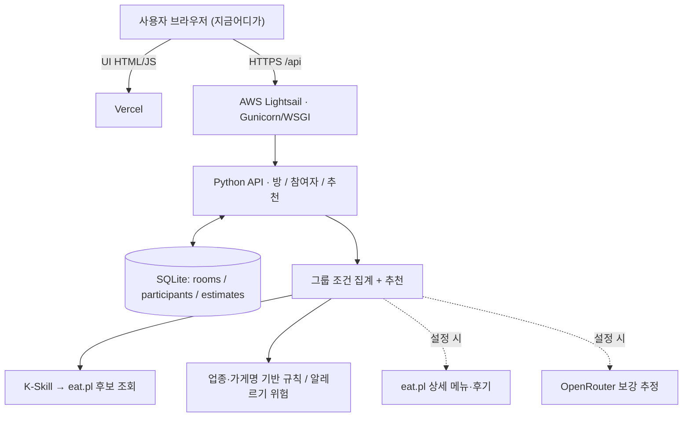

# 시스템 아키텍처 · 데이터 흐름

이 문서는 BDAI9 팀의 **실제 구현 구조**를 설명합니다. 개인 저장소의 코드는 서버 전체가 아니라 [작은 독립 랭킹 예제](../examples/group_ranker.py)입니다.

## 전체 구조



- **Frontend:** Vercel에 배포한 HTML/CSS/JavaScript. 6단계 모임 선택·링크 공유·추천 결과 표시
- **Backend:** AWS Lightsail에서 HTTPS 프록시 뒤에 Python WSGI/Gunicorn 단일 worker 서비스
- **Storage:** SQLite가 모임, 참여 응답, 추정 캐시를 보관
- **Places:** K-Skill 프록시의 eat.pl/BC카드 가맹점 후보와 제공처 기반 지표
- **Ranking:** 명시적 투표 우선, 조건별 점수·안전 제외, 불확실성 표시
- **Optional:** 메뉴·후기·OpenRouter 보강 (없어도 규칙 기반 후보 출력 가능)

## 실제 처리 단계

```text
모임 생성 → 방장 토큰 발급 → 공유 링크
   ↓
참여자: 이름·음식·예산·분위기·알레르기
   ↓
SQLite 저장 → 집계(음식 종류별 득표)
   ↓
K-Skill 후보 조회 + 업종 분류·가격 추정
   ↓
알레르기 고위험 신호 제외
   ↓
식당: 음식 득표 우선 / 그다음 세부 점수·매출 순위
   ↓
가게별 추천 근거·불확실성·eat.pl 상세 URL
   ↓
추가 상세 결과가 달라지면 해당 화면 영역만 갱신
```

## 핵심 API

| 메서드 | 경로 | 기능 |
| --- | --- | --- |
| GET | `/api/options` | 입력 선택지 |
| POST | `/api/regions/check` | 지역·역 이름 검증 |
| POST | `/api/rooms` | 모임 생성 |
| GET | `/api/rooms/{id}` | 참여자 현황 |
| POST | `/api/rooms/{id}/participants` | 선호 저장 |
| PUT/DELETE | `/api/rooms/{id}/participants/{pid}` | 본인 응답 수정·삭제 |
| POST | `/api/rooms/{id}/recommend` | 집계 결과 기반 추천 |
| DELETE | `/api/rooms/{id}` | 방장 권한으로 방 삭제 |

API 응답·보안 검증은 팀 소스 [`moim/server.py`](https://github.com/BDAI9/2026-eatpl-group-venue-recommender/blob/main/moim/server.py)와 [`moim/wsgi.py`](https://github.com/BDAI9/2026-eatpl-group-venue-recommender/blob/main/moim/wsgi.py)를 기준으로 합니다.

## 역할별 소스 연결

| 분야 | 원본 |
| --- | --- |
| K-Skill 응답 변환/검증 | [`moim/eatpl.py`](https://github.com/BDAI9/2026-eatpl-group-venue-recommender/blob/main/moim/eatpl.py) |
| SQLite 영속화 | [`moim/store.py`](https://github.com/BDAI9/2026-eatpl-group-venue-recommender/blob/main/moim/store.py) |
| 운영 중 일관성 백업 | [`moim/backup.py`](https://github.com/BDAI9/2026-eatpl-group-venue-recommender/blob/main/moim/backup.py) |
| 다수결·점수·안전 제외 | [`moim/recommend.py`](https://github.com/BDAI9/2026-eatpl-group-venue-recommender/blob/main/moim/recommend.py) |
| 비동기 결과 갱신 | [`web/v2.js`](https://github.com/BDAI9/2026-eatpl-group-venue-recommender/blob/main/web/v2.js) |

## 운영 경계

- 운영 환경변수와 SQLite DB는 저장소 밖에서 관리합니다.
- 링크를 아는 사용자는 모임 정보에 접근할 수 있으므로 공개 서비스에는 보관·삭제·접근 정책 보강이 필요합니다.
- Vercel의 배포 성공은 AWS 백엔드 갱신이나 실제 추천의 성공을 보장하지 않습니다.
- 실제 매장 가격·영업시간·재료·알레르기 안전 여부는 매장 확인이 필요합니다.

[README](../README.md) · [기술적 의사결정](engineering.md) · [본인 기여 근거](evidence.md)